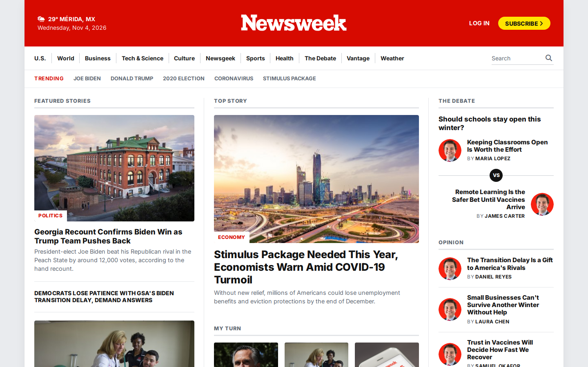

# 7 Using Bootstrap

> A responsive replica of the Newsweek.com homepage, built with Bootstrap 5, semantic HTML and a small amount of vanilla JavaScript.



## Features

- Responsive layout for desktop, tablet and mobile, built on the Bootstrap 5 grid
- Mobile navigation menu (Bootstrap offcanvas) with search
- Featured stories, top story, debate, opinion, magazine, editor's pick and world sections
- Newsletter sign-up forms with client-side email validation
- Current date in the header and current year in the footer
- Accessible markup: skip link, landmarks, labelled forms, descriptive `alt` text, visible focus styles and WCAG AA color contrast
- Back-to-top button and `prefers-reduced-motion` support

## Built With

- HTML5
- CSS3 (custom properties)
- Bootstrap 5.3
- Font Awesome 6
- Vanilla JavaScript

## Live Demo

[Live Demo Link](https://vichuge.github.io/7-using-bootstrap/)

## Getting Started

1. Clone the repository:

   ```bash
   git clone https://github.com/vichuge/7-using-bootstrap.git
   ```

2. Open `index.html` in your browser. No build step is needed.

### Linters

The project uses the [Microverse linters](https://github.com/microverseinc/linters-config/tree/master/html-css): Lighthouse, Webhint and Stylelint. They run automatically on every pull request. To run them locally:

```bash
npm install --save-dev hint@7.x stylelint@13.x stylelint-scss@3.x stylelint-config-standard@21.x stylelint-csstree-validator@1.x
npx hint .
npx stylelint "**/*.{css,scss}"
```

## Authors

👤 **Victor Pacheco**

- GitHub: [@vichuge](https://github.com/vichuge)
- LinkedIn: [LinkedIn](https://www.linkedin.com/in/victor-pacheco-7946aab2/)

👤 **Alexis Varela**

- GitHub: [@alexisbec](https://github.com/alexisbec)
- LinkedIn: [LinkedIn](https://www.linkedin.com/in/alexis-varela-2584111b7/)

## 🤝 Contributing

Contributions, issues, and feature requests are welcome.

Feel free to check the [issues page](https://github.com/vichuge/7-using-bootstrap/issues).

## Show your support

Give a ⭐️ if you like this project!

## Acknowledgments

- Original design by [Newsweek](https://www.newsweek.com/). This is a learning project and is not affiliated with Newsweek.

## 📝 License

This project is [MIT](https://github.com/vichuge/7-using-bootstrap/blob/main/LICENSE) licensed.
